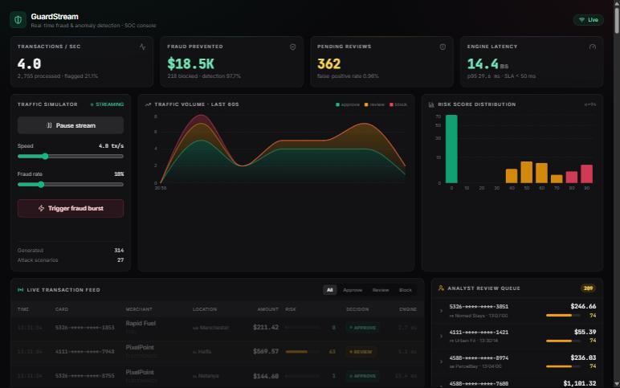
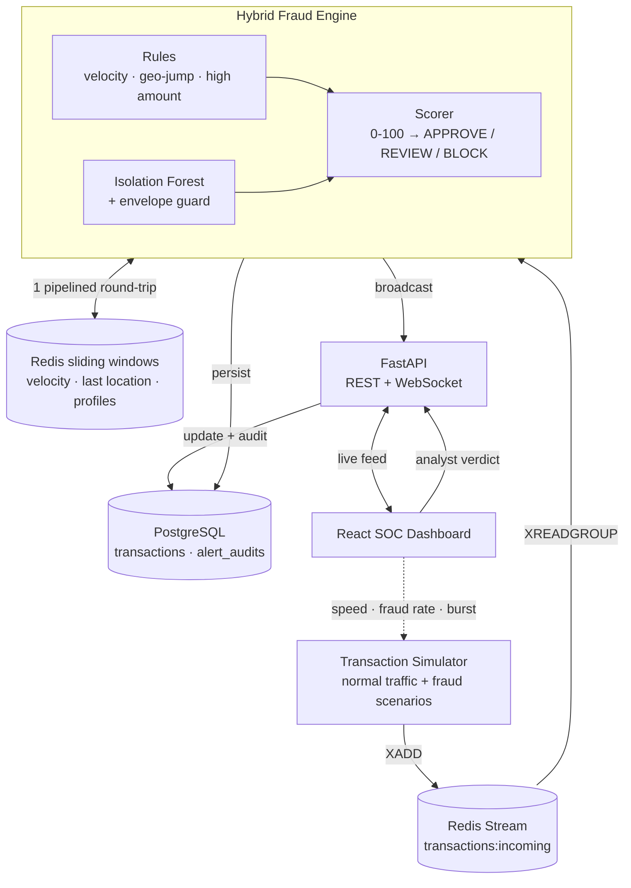
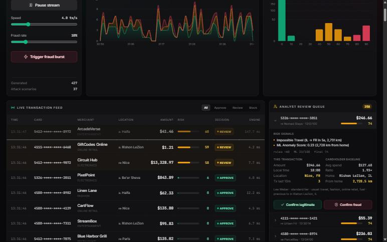

# GuardStream

**Real-time financial fraud & anomaly detection.** A streaming pipeline that scores every card transaction in a few milliseconds with a hybrid engine (deterministic rules over Redis sliding windows + an Isolation Forest model), persists the verdict to PostgreSQL, and pushes it live to a SOC analyst dashboard.

[](https://github.com/yakov-ashgar27/guardstream/actions/workflows/ci.yml)




📐 **System design:** [DFD (levels 0–1) and ERD](docs/DIAGRAMS.md), drawn from the code.

## Highlights

- **Streaming ingestion with recovery:** Redis Streams consumer group with at-least-once delivery, replay of un-acked messages on restart, and idempotent writes.
- **Hybrid detection:** explainable business rules over Redis sliding windows, combined with an unsupervised Isolation Forest. Every decision carries human-readable reasons.
- **Fixing a known ML weakness:** Isolation Forests cannot flag values outside their training range, so an out-of-envelope guard covers that gap ([details](#2-isolation-forest-engineml_modelpy)).
- **Analyst workflow:** a review queue with full context, verdicts persisted in an audit table, and live KPIs including detection and false-positive rates measured against ground truth.
- **One-command setup:** `docker compose up --build` starts PostgreSQL, Redis, the API and the dashboard, with health checks and automatic schema creation.

---

## Quick start

```bash
git clone https://github.com/yakov-ashgar27/guardstream.git
cd guardstream
docker compose up --build
```

| Service | URL |
| --- | --- |
| SOC dashboard | http://localhost:3000 |
| REST API + Swagger | http://localhost:8000/docs |
| WebSocket feed | ws://localhost:8000/ws/transactions |

Tables are created automatically on startup, the ML model trains in about a second, and the simulator starts streaming right away. Press **Trigger fraud burst** in the dashboard to inject a wave of attacks.

Run the engine unit tests:

```bash
docker compose exec backend pytest -q
```

---

## Architecture



### Request path for one transaction

1. The simulator `XADD`s an authorization request to the Redis Stream.
2. The engine reads it through a **consumer group** (`XREADGROUP`, at-least-once; un-acked messages are replayed on restart and persisted idempotently with `MERGE`).
3. **One pipelined Redis round-trip** reads the card's previous location, evicts stale entries from its velocity sorted set, counts the 60 s / 10 min windows, then records the new transaction.
4. Rules and the ML model run in-process, then the scorer combines them. Latency is measured from step 3 onward and typically comes in well under the 50 ms budget (see *Live run* below).
5. The batch is committed to PostgreSQL, acked on the stream, and broadcast over WebSocket.

---

## Hybrid scoring logic

### 1. Deterministic rules (`engine/rules.py`)

| Rule | Condition | Points |
| --- | --- | --- |
| `RULE_VELOCITY` | > 3 transactions on one card within 60 s (Redis sorted set `ZCOUNT`) | **+45** |
| `RULE_GEO_JUMP` | Different country than the previous transaction within 30 min | **+60** |
| `RULE_HIGH_AMOUNT` | Amount > $3,000 on a *standard*-tier card | **+35** |

### 2. Isolation Forest (`engine/ml_model.py`)

- **Training:** on startup, 2,000 synthetic *normal* transactions are drawn from the same behavioural model the simulator uses (`simulator/catalog.py`), so the model and the traffic agree on what "normal" means.
- **Features:** `amount`, `hour_of_day`, `distance_from_home_km`, `tx_count_last_10m`, `amount_ratio_to_user_avg`. Amount, distance and ratio are log-scaled.
- **Calibration to 0–100:** the raw anomaly score is mapped piecewise-linearly on training percentiles (median → 0, p95 → 15, p99.5 → 35, p99.5 + 0.08 → 100).
- **Out-of-envelope guard:** Isolation Forests cannot extrapolate. A point far *outside* the training range (for example, 6,000 km from home when the baseline never exceeds about 300 km) follows the same splits as the boundary points and looks ordinary. To catch this, the model also measures how far each feature lies beyond the training 0.5–99.5 percentile envelope, in IQR units. The reported ML risk is the larger of the two signals.

### 3. Aggregation (`engine/scorer.py`)

```
risk = min(100, Σ rule points + 0.6 × ML risk)

  0–39  → APPROVE  (green)
 40–74  → REVIEW   (amber, routed to the analyst queue)
 75–100 → BLOCK    (red, auto-blocked)
```

Every decision records exact `triggered_reasons`, for example:

```json
["Impossible Travel (IL -> UK in 4m, 3,563 km)", "ML Anomaly Score: 0.97 (3,563 km from home)"]
```

### Live run (Docker Desktop on Windows, 4 tx/s, 10 % fraud rate)

Measured from the running stack's `/api/stats` endpoint after about 3,000 transactions:

| Metric | Value |
| --- | --- |
| Engine latency | avg ≈ 14 ms, p95 ≈ 28 ms (occasional single spikes above 50 ms) |
| Detection rate (simulated fraud flagged) | ≈ 98 % |
| False-positive rate (normal traffic flagged) | ≈ 1.1–1.3 % |

A single click on **Trigger fraud burst** produced 10 auto-blocks and 16 new review cases within 10 seconds.



### Offline engine evaluation

These numbers come from running the engine on synthetic traffic (`tests/test_engine.py` and a calibration script), not from a live deployment:

| Traffic | Outcome |
| --- | --- |
| 3,000 normal transactions | 99.5 % APPROVE, 0.5 % REVIEW, 0 BLOCK |
| Impossible travel | 100 % flagged (~68 % BLOCK, ~32 % REVIEW) |
| Card testing | Micro charges go to REVIEW; from the 4th charge in 60 s on, BLOCK |
| High value at night (10–15× avg) | ~94 % flagged, mostly REVIEW for analyst confirmation |

The dashboard shows live **detection rate** and **false-positive rate**, computed against the simulator's ground-truth labels. The labels are stored in `sim_pattern` and are never visible to the engine.

---

## Simulator

- **1,000 persistent cardholders** with a home city (IL 60 %, UK/US/DE/FR 10 % each), a card tier (15 % premium), an average spend baseline and 3–5 habitual merchant categories.
- **Normal traffic:** Poisson arrivals at the configured TPS. Purchases follow the cardholder's categories, home city (88 %) or a domestic trip, and a realistic hour-of-day curve. A per-card cooldown keeps legitimate users from tripping velocity rules.
- **Fraud scenarios**, each running as its own asyncio task:
  - **Geo-jump:** a legitimate purchase at home, then the same card used abroad 2–8 s later.
  - **Card testing:** 4–6 charges of $1–$3 at a digital-goods merchant within a minute.
  - **High-value anomaly:** 10–15× the user's average, at 01:00–04:00 local time.
- `hour_of_day` comes from the merchant-local transaction time sent with the request (the equivalent of ISO 8583 DE 12). This keeps the demo behaving the same at any wall-clock time.

---

## API

| Method | Path | Description |
| --- | --- | --- |
| `GET` | `/api/health` | Redis + model readiness |
| `GET` | `/api/transactions?limit=&decision=&card_id=` | Recent transactions |
| `GET` | `/api/transactions/review-queue` | Pending REVIEW cases, highest risk first |
| `GET` | `/api/transactions/{id}` | Full risk breakdown |
| `PATCH` | `/api/transactions/{id}/review` | `{"action": "APPROVE" \| "BLOCK", "analyst": "...", "notes": "..."}`: updates the transaction and writes an `alert_audits` row |
| `GET` | `/api/stats` | KPI snapshot |
| `GET` / `PATCH` | `/api/simulator` | Read or change `running`, `tps`, `fraud_rate` |
| `POST` | `/api/simulator/burst` | `{"size": 8}`: inject attack scenarios immediately |
| `WS` | `/ws/transactions` | `snapshot`, then `transaction`, `stats` (1 Hz), `review_update`, `simulator` messages |

---

## Project structure

```text
guardstream/
├── docker-compose.yml
├── backend/
│   ├── Dockerfile · requirements.txt · pytest.ini
│   ├── app/
│   │   ├── main.py            # lifespan wiring, REST & WebSocket endpoints
│   │   ├── config.py          # env-driven settings & thresholds
│   │   ├── database.py        # async engine/session, auto-create tables with retry
│   │   ├── models.py          # Transaction, AlertAudit
│   │   ├── schemas.py         # Pydantic v2 models
│   │   ├── redis_client.py    # streams + sliding-window helpers
│   │   ├── realtime.py        # WebSocket fan-out, KPI metrics
│   │   ├── engine/
│   │   │   ├── features.py    # feature extraction
│   │   │   ├── rules.py       # deterministic rules
│   │   │   ├── ml_model.py    # Isolation Forest + calibration
│   │   │   ├── scorer.py      # hybrid aggregation & decision
│   │   │   ├── processor.py   # stream consumer: evaluate → persist → broadcast
│   │   │   └── state.py
│   │   └── simulator/
│   │       ├── catalog.py     # cities, merchants, cardholders, normal behaviour
│   │       └── generator.py   # controllable traffic + fraud scenarios
│   └── tests/test_engine.py
└── frontend/
    ├── Dockerfile · nginx.conf · vite.config.ts · tailwind.config.js
    └── src/
        ├── App.tsx
        ├── types/transaction.ts
        ├── hooks/useTransactionStream.ts
        ├── lib/ (api, format)
        └── components/
            ├── HeaderStats.tsx · SimulatorControls.tsx
            ├── LiveFeed.tsx · RiskCharts.tsx · ReviewQueue.tsx · ui.tsx
```

---

## Local development without Docker for the app

```bash
docker compose up -d postgres redis

# backend
cd backend && python3.13 -m venv .venv && source .venv/bin/activate
pip install -r requirements.txt
uvicorn app.main:app --reload

# frontend (new terminal)
cd frontend && npm install && npm run dev   # http://localhost:5173, proxies /api and /ws to :8000
```

All thresholds and simulator defaults can be overridden with environment variables (see `.env.example`).

## Possible extensions

- Kafka in place of Redis Streams, with partitioning by `card_id` for horizontal scale
- Analyst feedback loop that retrains a supervised model on confirmed fraud/legit labels
- SHAP explanations per transaction
- Prometheus metrics and Grafana dashboards

## License

[MIT](LICENSE)
