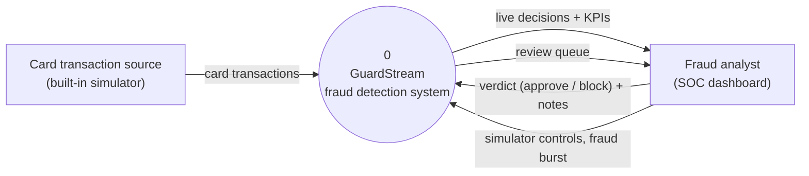
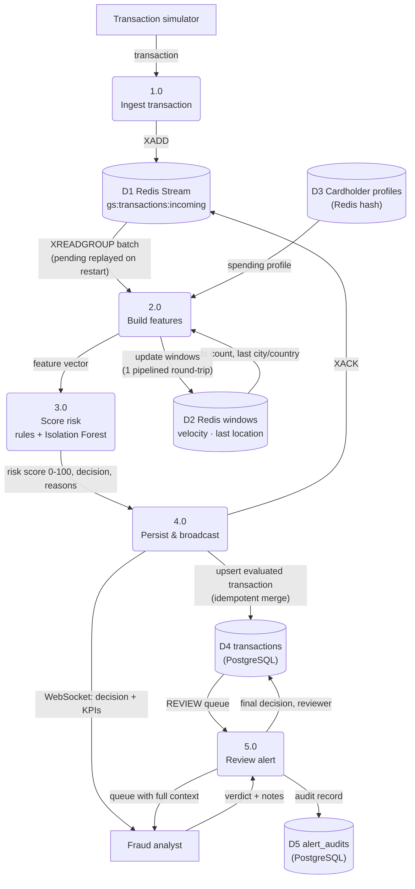
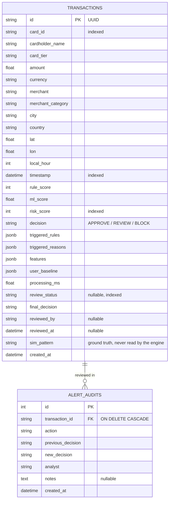

# GuardStream: Data Flow & Data Model

These diagrams are drawn from the code: the ORM models in [`backend/app/models.py`](../backend/app/models.py), the Redis access in [`backend/app/redis_client.py`](../backend/app/redis_client.py) and the pipeline in [`backend/app/engine/`](../backend/app/engine/). GitHub renders them directly.

**DFD notation:** rectangles are external entities, numbered rounded boxes are processes, cylinders are data stores.

## DFD Level 0: context diagram

## DFD Level 1

## ERD (PostgreSQL)

`alert_audits` is append-only: every analyst verdict adds a row, so the history of each decision is kept. A composite index on `(review_status, timestamp)` serves the review queue.

### Redis structures (not relational, shown for completeness)

| Key | Type | Holds | Lifetime |
|---|---|---|---|
| `gs:transactions:incoming` | Stream + consumer group | Incoming transactions until acknowledged | Until `XACK` |
| `gs:vel:{card_id}` | Sorted set | Transaction timestamps for velocity rules | Feature window + 60 s |
| `gs:last:{card_id}` | Hash | Last city, country and position | Geo window + 60 s |
| `gs:profiles` | Hash | Each card's spending profile (JSON) | Seeded at start-up |
